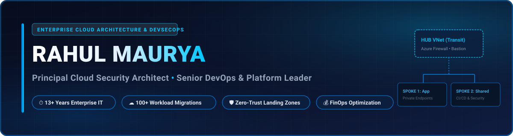
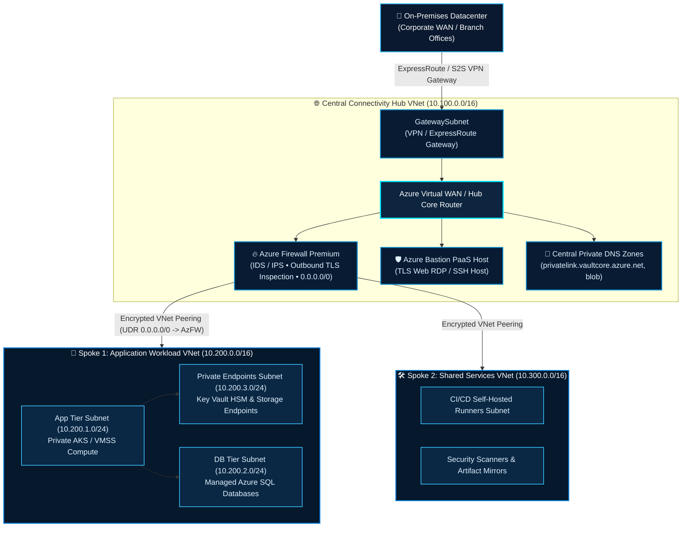
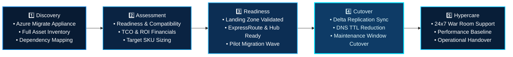
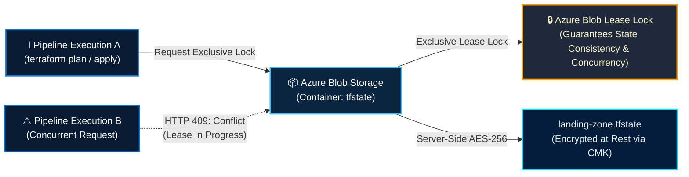
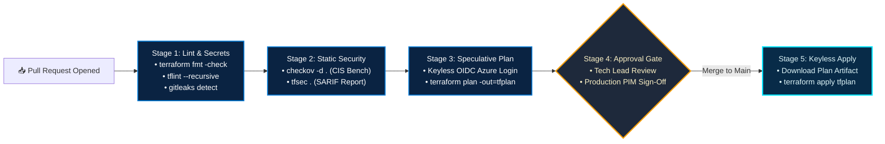

<div align="center">

  <!-- ================= ANIMATED HERO BANNER ================= -->
  <a href="https://github.com/Dev-opsRahul">
    
  </a>

  <!-- ================= DYNAMIC ANIMATED TYPING TERMINAL ================= -->
  <a href="https://github.com/Dev-opsRahul">
    
  </a>

  <br/>

  <!-- ================= STATUS BADGES ================= -->
  <p align="center">
    
    
    
    
    
    <a href="https://linkedin.com" target="_blank">
      
    </a>
  </p>

  <!-- ================= DYNAMIC GITHUB TROPHIES ================= -->
  <a href="https://github.com/Dev-opsRahul">
    
  </a>

  <!-- ================= QUICK NAVIGATION ================= -->
  <p align="center">
    <b>
      <a href="#-about-me">Executive Summary</a> &nbsp; • &nbsp;
      <a href="#-the-senior-mindset-business--architecture-alignment">Senior Mindset</a> &nbsp; • &nbsp;
      <a href="#-10-scalability--quality-pillars">10 Quality Pillars</a> &nbsp; • &nbsp;
      <a href="#-enterprise-governance-identity--caf-management-hierarchy">Governance & CAF</a> &nbsp; • &nbsp;
      <a href="#-enterprise-hub-and-spoke-networking-architecture">Hub & Spoke</a> &nbsp; • &nbsp;
      <a href="#-end-to-end-cloud-migration-strategy-100-workloads">100+ Migration</a> &nbsp; • &nbsp;
      <a href="#-multi-layered-defense-in-depth-security">Security</a> &nbsp; • &nbsp;
      <a href="#-terraform-landing-zone-automation--state-governance">Terraform IaC</a> &nbsp; • &nbsp;
      <a href="#-azure-repos--devsecops-pipeline-architecture">DevSecOps</a> &nbsp; • &nbsp;
      <a href="#-finops-cloud-financial-management">FinOps</a> &nbsp; • &nbsp;
      <a href="#-vendor-management--delivery-governance">Vendor & RACI</a> &nbsp; • &nbsp;
      <a href="#-github-metrics--activity">Metrics</a> &nbsp; • &nbsp;
      <a href="#-connect--collaborate">Contact</a>
    </b>
  </p>

</div>

---

## 👨‍💻 About Me

I am a **Principal Cloud Architect & Senior DevSecOps Leader** with **13+ years of enterprise IT experience** architecting, automating, and securing mission-critical infrastructure across **Microsoft Azure, AWS, and Hybrid Datacenters**. My career is defined by transforming complex enterprise requirements into secure, cost-optimized, and resilient cloud landing zones while leading cross-functional teams, orchestrating enterprise migrations, and establishing automated governance.

### Core Architecture & Leadership Spectrum:
- **Enterprise Cloud Architecture & Landing Zones:** Designing scalable Azure CAF (Cloud Adoption Framework) Landing Zones and AWS multi-account architectures with management group hierarchies, subscription boundaries, Hub-and-Spoke connectivity, and ExpressRoute peering.
- **Large-Scale Enterprise Migrations:** Leading the discovery, dependency mapping, TCO estimation, landing zone readiness, cutover execution, and hypercare governance for **100+ enterprise workloads** transitioning from on-prem datacenters to Azure with zero unplanned downtime.
- **Infrastructure as Code (IaC) & State Governance:** Authoring enterprise-grade, modular Terraform/Terragrunt suites utilizing remote state locking (Azure Blob Lease), speculative planning, automated drift detection, and pre-deployment policy gates.
- **Shift-Left DevSecOps & Keyless Automation:** Engineering multi-stage YAML pipelines (**Azure DevOps & GitHub Actions**) with integrated secret scanning (**Gitleaks**), static analysis (**TFLint, tfsec, Checkov**), container vulnerability audits (**Trivy**), and **Keyless OpenID Connect (OIDC)** authentication.
- **Zero-Trust & Defense-in-Depth Security:** Implementing strict network microsegmentation via Azure Firewall Premium (TLS inspection & IDS/IPS), NSGs/ASGs, Azure Bastion, Private Endpoints for all PaaS services, and dynamic secrets management with Azure Key Vault HSM and Privileged Identity Management (PIM).
- **FinOps & Cloud Financial Governance:** Institutionalizing cost management frameworks—eliminating orphan disks and unassociated IPs, rightsizing compute workloads, modeling Reserved Instances/Savings Plans, and tuning log ingestion (DCR) to drive 20%+ annual cloud savings.
- **Executive Delivery, Vendor Management & Mentorship:** SOW drafting and review, vendor evaluation matrices, RACI ownership, architecture review boards (ARB), post-incident retrospectives, and upskilling engineering teams.

> **Architectural Doctrine:** *Enterprise infrastructure must be treated as immutable software: code-defined, version-controlled, policy-governed, cost-optimized, and deployed with zero manual intervention.*

---

## 🧠 The Senior Mindset: Business & Architecture Alignment

At the Senior/Principal level, technical decisions are driven by asking: **"What is the business? What is the functional domain?"**

```
                              [ Experienced Mindset ]
                                         |
                   "What is the Business & Functional Domain?"
                                         |
            +----------------------------+----------------------------+
            |                                                         |
[ Infrastructure Design & Implementation ]     [ Application System Design & Implementation ]
- Cloud Architecture & Landing Zones           - Microservices vs Monolith
- DevSecOps & Infrastructure as Code           - API Gateways & Service Mesh
- Cloud Migration & App Modernization          - State & Caching Strategy
- Governance, Security, DR, FinOps             - Messaging & Event-Driven Patterns
```

### Executive & Leadership Responsibilities:
* **Leadership & Team Upskilling:** Running knowledge transfer (KT) sessions, mentoring junior and mid-level engineers, leading architectural review boards, and conducting senior technical interview panels.
* **Vendor & Service Management:** SOW negotiations, deliverable sign-offs, vendor SLA tracking, and operational governance across third-party technology partners.
* **Pre-Sales & Techno-Functional Proposals:** Technical estimations, Proof of Concept (POC) execution, solution blueprints, and commercial RFP/RFI responses.
* **Delivery Governance:** Authoring standard operating procedures (SOPs), conducting blameless incident retrospectives, and enforcing enterprise architecture compliance.

---

## 🏛️ IT Career Tracks & Roles Matrix

```
+------------+       +---------------+       +---------+       +----------------------+       +----------------+
|   Sales    | ----> |   Pre-Sales   | ----> |   TAM   | ----> | Enterprise Architect | ----> | Technical Lead |
| Commercial |       | Techno-       |       | Tech    |       | Infra + Application  |       | Infra / App    |
| Focus      |       | Functional    |       | Account |       | Strategy & Design    |       | Execution      |
|            |       | Proposals     |       | Manager |       |                      |       |                |
+------------+       +---------------+       +---------+       +----------------------+       +----------------+
```

* **Sales:** Business development, commercial negotiations, and client executive engagement.
* **Pre-Sales (Techno-Functional):** RFP/RFI technical responses, solution estimations, architecture proposals, and executive client presentations.
* **TAM (Technical Account Manager):** Trusted technical advisor, governance, operational escalations, account health, and risk mitigation.
* **Enterprise Architect:** Holistic enterprise technology blueprint spanning infrastructure, security, data, and application ecosystems.
* **Technical Lead:** Hands-on technical leadership, sprint execution, IaC/code reviews, and architectural enforcement.

---

## 🎯 10 Scalability & Quality Pillars

Every enterprise cloud solution and migration I architect is evaluated against these ten core pillars:

```
+--------------------------------------------------------------------------------------------------+
|                                    10 Scalability & Quality Pillars                               |
|                                                                                                  |
|  1. Scalable      2. Robust        3. Secure        4. Reliable       5. Portable                |
|  6. Governed      7. High Avail    8. Cost-Optim    9. Backed Up      10. Compliant & Monitored  |
+--------------------------------------------------------------------------------------------------+
```

| Pillar | Architectural Implementation Standard |
| :--- | :--- |
| **1. Scalable** | Horizontal auto-scaling using Virtual Machine Scale Sets (VMSS) across Availability Zones and dynamic container scaling (HPA/KEDA). |
| **2. Robust** | Fault-tolerant design with redundant paths, health probes, automated failure detection, and self-healing mechanisms. |
| **3. Secure** | Zero-Trust defense-in-depth model across identity, network perimeter, compute runtime, and data encryption (CMK). |
| **4. Reliable** | Proven recovery patterns, circuit breakers, and validated disaster recovery strategies with verified RTO/RPO targets. |
| **5. Portable** | Cloud-agnostic IaC templates (Terraform/OpenTofu) and containerized workloads adhering to OCI standards. |
| **6. Governed** | Cloud Adoption Framework (CAF) compliance enforced by automated Azure Policy initiatives at the Management Group tier. |
| **7. High Availability** | Multi-zone deployments (ZRS/VMSS) and multi-region pairing backed by Azure Site Recovery (ASR) and global traffic routing. |
| **8. Cost-Optimized** | Continuous FinOps auditing, compute rightsizing, RI/Savings Plan commitments, and automated off-hours scheduling. |
| **9. Backed Up** | Immutable Azure Backup vaults, Geo-Redundant Storage (GRS), snapshot policies, and periodic restore verification drills. |
| **10. Compliant & Monitored** | Centralized Log Analytics workspaces, Azure Monitor Agent (AMA), DCR log filtering, and CIS/NIST 800-53 auditing. |

---

## 🏢 Enterprise Governance, Identity & CAF Management Hierarchy

### Cloud Adoption Framework (CAF) Methodology
I guide enterprise transformations using the Microsoft CAF framework across six iterative phases:
* **Strategy:** Documenting business motivations, strategic outcomes, and clear return on investment (ROI).
* **Plan:** Workload alignment, digital estate rationalization, organizational RACI, and cloud skill readiness.
* **Ready:** Landing zone preparation, tenant hierarchy, identity synchronization, and network connectivity foundation.
* **Adopt:** Migration waves (Rehost, Refactor, Rearchitect) and modern application deployment sprints.
* **Govern:** Continuous guardrails using Azure Policy, cost management alerts, and compliance baselines.
* **Secure & Manage:** Defender for Cloud integration, automated patch baselines, SIEM integration, and SRE operations.

### Tenant & Management Group Hierarchy

```
                            [ Microsoft Entra ID Tenant ]
                                          |
                              [ Tenant Root Group ]
                                          |
         +--------------------------------+--------------------------------+
         |                                |                                |
[ Platform Management Group ]   [ Landing Zones (Workloads) ]    [ Decommissioned / Sandbox ]
   |-- Identity (AD/DNS)           |-- Corp (Internal Only)         |-- Sandbox MG
   |-- Management (Logs/Mon)       |-- Online (Public/DMZ)          |-- Decommissioned MG
   `-- Connectivity (Hub/Firewall) |-- Dev Subscriptions
                                   |-- UAT Subscriptions
                                   `-- Prod Subscriptions
```

### Governance Best Practices:
* **Subscription Isolation Boundaries:** Segregating environments (`Dev`, `UAT`, `Prod`) into distinct subscriptions to prevent noisy neighbors, enforce blast-radius isolation, and simplify cost center billing.
* **Azure Policy & Initiatives:** Assigning built-in initiatives (e.g., CIS Azure Benchmark, Microsoft Cloud Security Benchmark) at the Management Group level with automated **Deny / AuditIfNotExists** effects and time-bound, documented exemptions.
* **Identity, RBAC & PIM:** Implementing group-based RBAC via Microsoft Entra ID; enforcing **Privileged Identity Management (PIM)** with Just-In-Time (JIT) role elevation, mandatory justification, and multi-stage managerial approvals.

---

## 🌐 Enterprise Hub-and-Spoke Networking Architecture

Centralized network perimeter providing encrypted hybrid transit, deep packet inspection, and isolated workload communication:



### Key Networking Elements:
* **IP Address Management (IPAM) & CIDR Planning:** Comprehensive pre-migration address mapping ensuring non-overlapping RFC 1918 CIDRs across on-prem and cloud VNets.
* **Centralized Traffic Inspection:** User Defined Routes (UDRs) associated with all spoke subnets forcing `0.0.0.0/0` and inter-spoke traffic through the Azure Firewall Premium.
* **Controlled Ingress & Egress:** Inbound traffic routed through Azure Application Gateway WAF v2 (OWASP Top 10); outbound internet traffic filtered via Azure Firewall application and network rules.
* **Private Connectivity:** Private Endpoints for all PaaS services (Key Vault, Storage Accounts, SQL Databases) linked to centralized Private DNS Zones in the Hub.

---

## 🚀 End-to-End Cloud Migration Strategy (100+ Workloads)

Proven enterprise methodology for migrating 100+ applications across Dev, UAT, and Production from on-prem datacenters to Azure:



### Comprehensive Migration Checklists:
* **Pre-Migration:** Run Azure Migrate discovery; map multi-tier application dependencies; verify ExpressRoute throughput and MTU; provision target CAF landing zones; establish fallback rollback runbooks.
* **During-Migration (Cutover Window):** Quiesce on-prem transactional workloads; execute final delta database replication; update DNS records with reduced TTLs; validate end-to-end telemetry.
* **Post-Migration & Hypercare:** Verify business transactions; conduct performance benchmarking against on-prem baselines; run a 24x7 dedicated war room for 2-4 weeks; finalize operational runbooks.

---

## 🛡️ Multi-Layered Defense-in-Depth Security

| Layer | Key Controls & Technologies | Enterprise Implementation Standard |
| :--- | :--- | :--- |
| **Identity Level** | Microsoft Entra ID, PIM, Conditional Access, MFA, Managed Identities | Zero permanent administrator rights; Just-In-Time role elevation with multi-factor authentication and automated expiration. |
| **Networking Level** | Hub-and-Spoke, Azure Firewall Premium, NSGs/ASGs, Private Endpoints, DDoS Standard | Default Deny network security rules; centralized egress TLS inspection; zero public IPs assigned to compute nodes. |
| **Governance Level** | Azure Policy initiatives, CIS Azure Benchmarks, Defender Secure Score | Automated policy assignment at Management Groups; automated compliance auditing and drift remediation. |
| **Compute Level** | Microsoft Defender for Servers, Disk Encryption with CMK, automated OS patching | Customer Managed Keys (CMK) via Key Vault HSM; vulnerability scanning; automated patch baselines via Azure Update Manager. |

---

## ⚙️ Terraform Landing Zone Automation & State Governance

Automating infrastructure delivery through repeatable, modular HCL and strict remote state locking:



### Production Remote State Backend Configuration:
```hcl
# Enterprise Azure Blob Storage Remote Backend with Entra ID Authentication
terraform {
  required_version = ">= 1.8.0"
  required_providers {
    azurerm = {
      source  = "hashicorp/azurerm"
      version = "~> 3.100.0"
    }
  }

  backend "azurerm" {
    resource_group_name  = "rg-terraform-state-mgmt"
    storage_account_name = "sttfstatelz001"
    container_name       = "tfstate"
    key                  = "enterprise.landingzone.tfstate"
    use_azuread_auth     = true # RBAC / Entra ID Keyless Authentication
  }
}
```

* **Remote State Governance:** State stored in dedicated, private Azure Storage Accounts with blob lease locking, geo-redundancy, and soft delete protection.
* **Automated Drift Detection:** Scheduled nightly pipelines running `terraform plan -detailed-exitcode` to detect unmanaged console changes.

---

## 🔄 Azure Repos & DevSecOps Pipeline Architecture



* **Branching Strategy:** Trunk-based development utilizing short-lived feature branches (`feature/*`, `fix/*`).
* **Branch Protection Policies:** Mandatory Pull Request (PR) reviews with minimum 2 senior approvals; `CODEOWNERS` enforcement; linear commit history; direct pushes and branch deletion strictly disabled on `main`.
* **Multi-Stage YAML Pipeline Lifecycle:**
  1. **Validate & Lint:** `terraform fmt -check`, `tflint --recursive`.
  2. **Security & Secret Scanning:** Gitleaks, Checkov (CIS Benchmarks), Aqua Trivy.
  3. **Cost Estimation:** Infracost breakdown posted as a pull request comment.
  4. **Speculative Plan:** Generates and publishes encrypted `tfplan` artifact.
  5. **Approval Gate:** Multi-party sign-off required for UAT and Production rollouts.
  6. **Keyless Apply:** OIDC-authenticated deployment executing the exact saved plan artifact.

```yaml
# Hardened Keyless OIDC Azure Deployment Pipeline
name: "Enterprise DevSecOps IaC Pipeline"

on:
  push:
    branches: [ main ]
  pull_request:
    branches: [ main ]

permissions:
  id-token: write
  contents: read
  security-events: write

jobs:
  security-audit:
    name: "Shift-Left Security & Linting"
    runs-on: ubuntu-latest
    steps:
      - uses: actions/checkout@v4
      - name: Run Gitleaks Secret Scan
        uses: gitleaks/gitleaks-action@v2
      - name: Run Checkov Static Analysis
        uses: bridgecrewio/checkov-action@master
        with:
          framework: terraform
          output_format: sarif
          output_file_path: results.sarif

  terraform-deploy:
    name: "Keyless Terraform Apply"
    needs: [security-audit]
    if: github.ref == 'refs/heads/main' && github.event_name == 'push'
    runs-on: ubuntu-latest
    steps:
      - uses: actions/checkout@v4
      - name: 'Authenticate to Azure via Keyless OIDC'
        uses: azure/login@v2
        with:
          client-id: ${{ secrets.AZURE_CLIENT_ID }}
          tenant-id: ${{ secrets.AZURE_TENANT_ID }}
          subscription-id: ${{ secrets.AZURE_SUBSCRIPTION_ID }}
      - name: Terraform Apply
        run: |
          terraform init
          terraform apply -auto-approve
```

---

## 💰 FinOps (Cloud Financial Management)

Cloud cost efficiency is an ongoing architectural responsibility:

* **Eliminate Waste:** Automated detection and destruction of unattached managed disks, obsolete VM snapshots, unassociated public IPs, and unused virtual network gateways.
* **Rightsizing:** Resizing over-provisioned virtual machines and App Service plans based on 30-day P95 CPU/Memory utilization metrics.
* **Commitment Discounts:** Procuring 1-year and 3-year Azure Reserved Instances (RIs) and Azure Savings Plans for steady-state workloads.
* **Automated Scheduling:** Automated start/stop runbooks powered by Azure Automation / Logic Apps shutting down non-production environments outside business hours.
* **Log Ingestion Tuning:** Reviewing Log Analytics workspace ingestion tables; deploying Data Collection Rules (DCR) to filter noisy diagnostic and performance counters at the source.

---

## 🔁 Backup, Disaster Recovery & High Availability

* **Storage Redundancy Models:**
  * **LRS (Locally Redundant Storage):** Synchronous replication within a single datacenter for development workloads.
  * **ZRS (Zone-Redundant Storage):** Synchronous replication across three availability zones in a region for high-availability production workloads.
  * **GRS (Geo-Redundant Storage):** Asynchronous replication to a secondary paired region for disaster recovery protection.
* **High-Availability Compute:** Deploying Virtual Machine Scale Sets (VMSS) across Availability Zones with automated health repair.
* **RTO & RPO Standards:**
  * **RTO (Recovery Time Objective):** Maximum allowable downtime before business services are restored.
  * **RPO (Recovery Point Objective):** Maximum allowable data loss measured in time (e.g., maximum 15 minutes of transactional delta).
* **Cross-Region Disaster Recovery:** Primary active region replicated continuously to a secondary paired region using **Azure Site Recovery (ASR)**.

---

## 📊 Enterprise Observability & SRE

* **Centralized Telemetry:** Central Log Analytics Workspace deployed per landing zone with RBAC-controlled access.
* **Azure Monitor Agent (AMA):** Streamlining agent footprint; utilizing Data Collection Rules (DCR) for targeted log collection.
* **Action Groups & Alert Routing:** Configuring metric-based and log-based alerts routed dynamically to Microsoft Teams, Slack, and PagerDuty for 24x7 incident response.

---

## 🤝 Vendor Management & Delivery Governance

Senior architects regularly evaluate, negotiate with, and govern technology partners and vendors.

```
[ RFI (Request for Information) ]
               |
[ RFP (Request for Proposal) ]
               |
[ Technical Evaluation Matrix (Architecture, Security, Cost) ]
               |
[ SOW (Statement of Work) & Commercials ]
               |
[ Project Sprints & Deliverable Milestones ]
               |
[ Acceptance Criteria Sign-Off & Payment Release ]
```

### Critical Governance Instruments:
* **Statement of Work (SOW):** Formal contractual document defining project scope, milestones, deliverables, acceptance criteria, assumptions, and liability terms.
* **Technical Evaluation Matrix:** Objective scoring of vendor architectures based on performance, security compliance, SLA guarantees, and TCO.
* **RACI Matrix:**
  * **R (Responsible):** The execution team performing the technical task.
  * **A (Accountable):** The single individual answerable for deliverable completion and sign-off.
  * **C (Consulted):** Domain subject matter experts providing input and review.
  * **I (Informed):** Stakeholders kept updated on progress and milestones.
* **Escalation Framework:** Pre-defined escalation paths with clear SLAs for technical blockers, delivery delays, or scope disputes.

---

## 📈 GitHub Metrics & Activity

<div align="center">

  <table border="0">
    <tr>
      <td align="center" width="50%">
        <a href="https://github.com/Dev-opsRahul">
          
        </a>
      </td>
      <td align="center" width="50%">
        <a href="https://github.com/Dev-opsRahul">
          
        </a>
      </td>
    </tr>
    <tr>
      <td align="center" colspan="2">
        <a href="https://github.com/Dev-opsRahul">
          
        </a>
      </td>
    </tr>
    <tr>
      <td align="center" colspan="2">
        <a href="https://github.com/Dev-opsRahul">
          
        </a>
      </td>
    </tr>
  </table>

</div>

---

## 🤝 Connect & Collaborate

I am always open to discussing **Enterprise Cloud Architecture**, **Large-Scale Migrations (100+ Workloads)**, **Zero-Trust Infrastructure**, **DevSecOps Automation**, and **Technical Leadership**. Feel free to connect or reach out!

<div align="center">

| Platform | Channel | Link |
| :--- | :--- | :--- |
| **LinkedIn** | Professional Leadership Profile | [Connect on LinkedIn](https://linkedin.com) |
| **GitHub** | Technical Portfolio & Modules | [@Dev-opsRahul](https://github.com/Dev-opsRahul) |
| **Focus Areas** | Architectural Specialization | Azure CAF Landing Zones, 100+ App Migrations, DevSecOps, FinOps, SOW/Vendor Governance |
| **Target Roles** | Enterprise Leadership | Principal Cloud Architect, Senior DevOps Architect, Staff Platform Lead |

</div>

<br/>

<div align="center">
  <sub>Architected with precision for enterprise-scale infrastructure. Built with Microsoft Azure, HashiCorp Terraform, and Cloud Adoption Framework (CAF) standards.</sub>
</div>