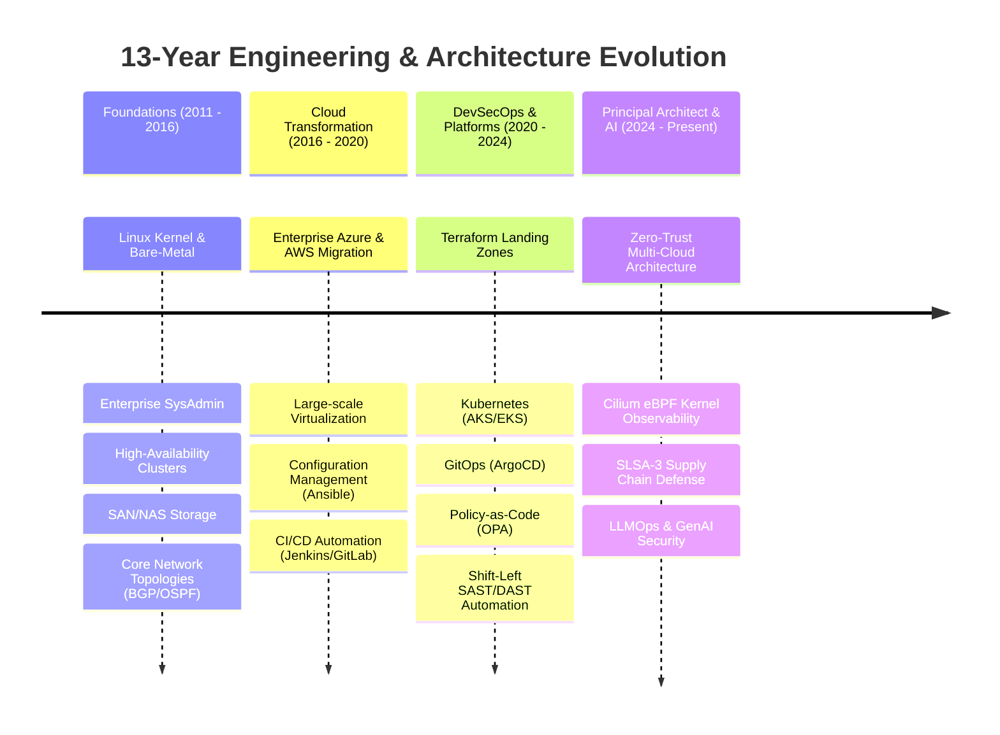
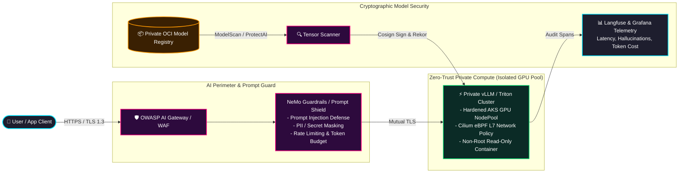
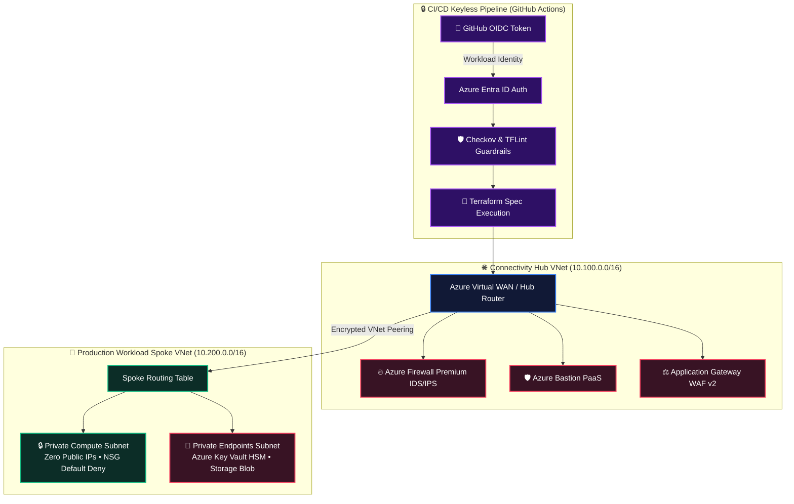
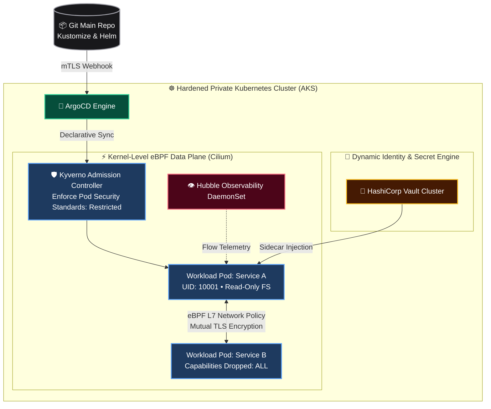

<!-- =========================================================================
     RAHUL MAURYA | PRINCIPAL DEVSECOPS & CLOUD SECURITY ARCHITECT
     13+ YEARS ENTERPRISE IT • ZERO TRUST • HARDENED K8S • LLMOPS SECURITY
========================================================================= -->

<!-- DYNAMIC ANIMATED HERO HEADER -->

<!-- DYNAMIC TYPING SVG ANIMATION -->

 

<!-- STRATEGIC BADGES -->

---

### 🛡️ Executive Technical Summary

With over **13 years of battle-tested enterprise IT experience**, I specialize in designing and delivering **zero-trust multi-cloud platforms, military-grade DevSecOps automation, and hardened Kubernetes ecosystems** for Fortune-scale environments.

My architectural approach shifts security from a reactive post-deployment gatekeeper to an **automated, mathematical guardrail embedded at every phase of the software and AI lifecycle**:
- **Enterprise Infrastructure as Code:** Architecting Azure CAF Landing Zones & AWS Control Tower architectures using Terraform Enterprise, Terragrunt, and OpenTofu with automated state locking and blast-radius minimization.
- **Zero-Trust Identity & Access (IAM):** Eradicating static credentials across CI/CD by standardizing on **Keyless OpenID Connect (OIDC)** Workload Identity Federation and HashiCorp Vault dynamic secret engines.
- **Next-Gen AI Security (LLMSecOps):** Hardening high-throughput private LLM inference clusters (vLLM / Triton) on GPU-enabled Kubernetes with eBPF network segmentation, prompt injection guardrails, and cryptographic model provenance.
- **Policy as Code (PaC) & Supply Chain Security:** Enforcing real-time admission controls using **Kyverno and OPA/Rego**, while generating CycloneDX SBOMs and keyless artifact attestations via **Sigstore (Cosign / Rekor)** for SLSA-3 compliance.

---

## 🧭 13-Year Enterprise Systems Journey

An architectural progression from bare-metal enterprise infrastructure to cutting-edge cloud platforms and AI security:

---

## 🤖 AI DevSecOps & Enterprise LLMOps Security

As enterprise workloads integrate generative AI and large language models, I architect the security platforms protecting model weights, inference infrastructure, and training data pipelines against the **OWASP Top 10 for LLMs**:

### Key AI Security Capabilities:
* **Private Isolated Model Serving:** Zero public internet exposure for model weights; private endpoints and Cilium eBPF network policies isolate GPU worker nodes.
* **Model Supply Chain Attestation:** Scanning PyTorch/Safetensors weights with `modelscan` and cryptographically signing models with Cosign before loading onto cluster memory.
* **Runtime Threat Mitigation:** In-line inspection of prompt vectors preventing indirect prompt injection, jailbreaking, and unauthorized data leakage.

---

## 🏛️ Flagship Enterprise Architectures

---

### 🌟 Flagship Project 1: Multi-Cloud Zero-Trust Hub-Spoke Landing Zone
**Target Repository:** [`azure-enterprise-secure-landing-zone`](https://github.com/Dev-opsRahul/azure-enterprise-secure-landing-zone)  
*Enterprise-ready Terraform architecture establishing a multi-subscription cloud perimeter with automated compliance guardrails.*

* **Core Highlights:**
  * **100% Secretless Deployments:** Eliminates long-lived Service Principal client secrets; authenticates runners via OpenID Connect (OIDC).
  * **Zero Public Attack Surface:** Compute instances deploy without public IPs, accessible only via Azure Bastion and TLS-terminated private ingress.
  * **Policy-as-Code Enforcement:** Pre-merge Checkov scans enforce 100% compliance with CIS Azure Benchmark v2.0.

---

### 🌟 Flagship Project 2: Hardened Zero-Trust Kubernetes Engine (AKS / Cilium eBPF / ArgoCD)
**Target Repository:** [`k8s-zero-trust-gitops-platform`](https://github.com/Dev-opsRahul/k8s-zero-trust-gitops-platform)  
*Production Kubernetes platform leveraging eBPF kernel-level networking, declarative GitOps, and dynamic secret injection.*

* **Core Highlights:**
  * **Cilium eBPF CNI:** Replaces legacy iptables with kernel-level eBPF filtering, delivering line-rate performance and L3-L7 microsegmentation.
  * **Automated GitOps Reconciliation:** ArgoCD controller manages infrastructure states with continuous drift detection and auto-healing.
  * **Kyverno Guardrails:** Rejects any workload attempting root execution, privilege escalation, or mounting writable root filesystems.

---

### 🌟 Flagship Project 3: End-to-End SLSA-3 Supply Chain Defense
**Target Repository:** [`slsa3-supply-chain-pipeline`](https://github.com/Dev-opsRahul/slsa3-supply-chain-pipeline)  
*Complete software supply chain hardening pipeline enforcing cryptographic signing, SBOM generation, and admission verification.*

```mermaid
flowchart LR
    classDef step fill:#1e1e2e,stroke:#38bdf8,stroke-width:2px,color:#ffffff;
    classDef scan fill:#3b0764,stroke:#c084fc,stroke-width:2px,color:#ffffff;
    classDef sign fill:#14532d,stroke:#4ade80,stroke-width:2px,color:#ffffff;
    classDef k8s fill:#1e3a8a,stroke:#93c5fd,stroke-width:2px,color:#ffffff;

    Commit[📥 Git Push Verified Commit]:::step --> SAST[🔍 Semgrep & Gitleaks]:::scan
    SAST --> Build[📦 Hermetic Container Build]:::step
    Build --> SBOM[📋 Syft SBOM Generation<br/>CycloneDX Format]:::scan
    SBOM --> Vuln[🛡️ Grype Vulnerability Scan<br/>Zero High/Critical Cutoff]:::scan
    Vuln --> Sign[✍️ Cosign Keyless Signing<br/>OIDC & Sigstore Rekor Log]:::sign
    Sign --> Attest[📜 Cosign SBOM Attestation]:::sign
    Attest --> Admission[☸️ Kyverno Admission Gate<br/>Verify Signature & Rekor Log Entry]:::k8s
    Admission --> Deploy([🚀 Production Pod Runtime]):::k8s
```

* **Core Highlights:**
  * **SLSA Level 3 Compliance:** Builds run hermetically with immutable provenance tracking every build dependency back to source commit.
  * **Keyless Cosign Signing:** Utilizes ephemeral certificates backed by Sigstore's Rekor transparency log, removing key management headaches.
  * **In-Cluster Admission Verification:** Pod deployments are rejected if container images lack valid cryptographic signatures and vulnerability attestations.

---

## 🛠️ Complete Technology Arsenal

### Cloud Platforms & Enterprise Perimeter

### Containers, Orchestration & Kernel Observability

### Zero-Trust IAM & Secrets Management

### DevSecOps, Policy-as-Code & Supply Chain

### AI DevSecOps & LLMOps Ecosystem

---

## 📈 Engineering Analytics & Continuous Contribution

 

<!-- ANIMATED CONTRIBUTION ACTIVITY GRAPH -->

---

## 📑 Production Architecture Decision Records (ADR Highlights)

To ensure long-term architectural integrity, every technical decision across my repositories is governed by formal Architecture Decision Records (ADRs):

* [**ADR-001: Mandating Keyless OpenID Connect (OIDC) over Static Service Principal Secrets**](https://github.com/Dev-opsRahul)  
  *Context:* Static credentials stored in CI/CD secrets present rotation overhead and exfiltration exposure.  
  *Decision:* Standardized on Microsoft Entra ID Workload Identity Federation across all workflows. Zero permanent secrets in GitHub.
* [**ADR-002: Transitioning Kubernetes Networking from iptables to Cilium eBPF**](https://github.com/Dev-opsRahul)  
  *Context:* Complex microservice topologies suffer latency degradation and lack deep L7 traffic auditing with standard kube-proxy.  
  *Decision:* Enforced Cilium eBPF as cluster CNI for line-rate kernel packet routing, Hubble flow metrics, and L7 API security policies.
* [**ADR-003: Implementing SLSA Level 3 Supply Chain Ingestion Controls**](https://github.com/Dev-opsRahul)  
  *Context:* Third-party container dependencies introduce unknown vulnerabilities and image tampering risks.  
  *Decision:* Cryptographic signing via Cosign, Syft SBOM generation, and Kyverno admission policy validation prior to cluster scheduling.

---

## 🤝 Enterprise Leadership & Strategic Engagement

* **Target Roles:** Principal DevSecOps Engineer, Distinguished Cloud Security Architect, Staff Platform Engineer, Head of Infrastructure Security.
* **Advisory & Consulting:** Zero-Trust Cloud Transformations, Multi-Subscription Landing Zones, Enterprise GitOps Migrations, AI/LLMOps Security.
* **Let's Connect:** Reach out on [LinkedIn](https://linkedin.com) or contact me directly via **[GitHub Discussions](https://github.com/Dev-opsRahul)**.

<!-- ANIMATED FOOTER WAVE -->

