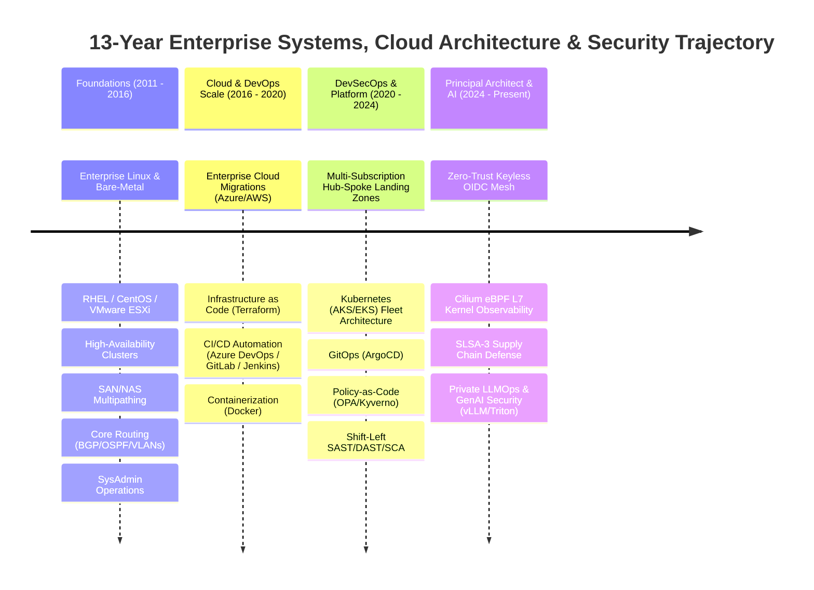
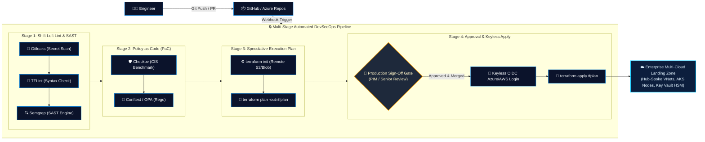
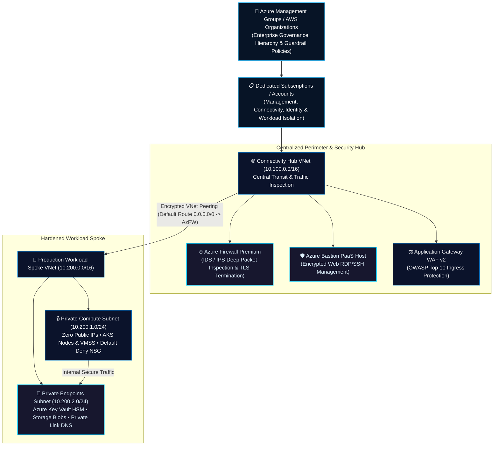
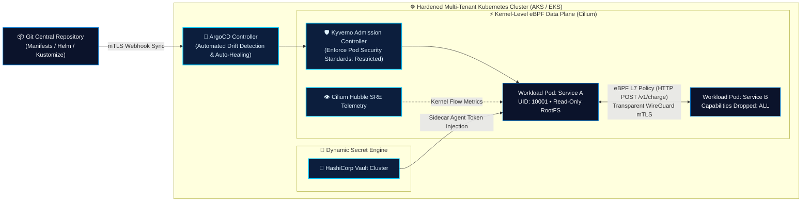
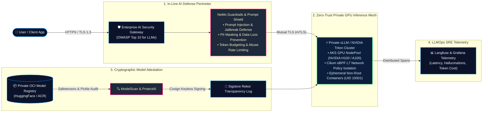
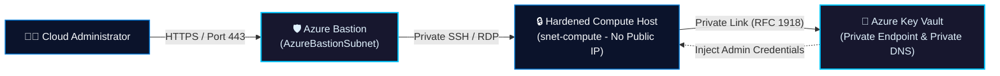
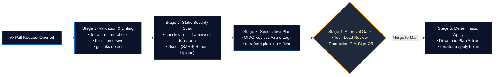
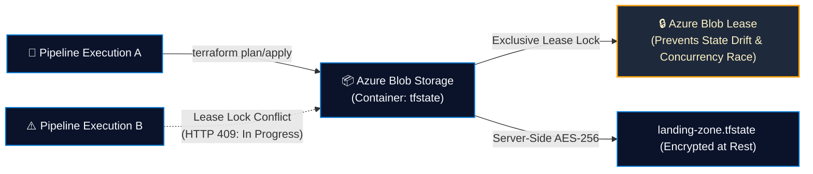

<div align="center">

  <!-- ================= HERO BANNER ================= -->
  

  <br/><br/>

  <!-- ================= STATUS BADGES ================= -->
  <p align="center">
    
    
    
    
    
    
    <a href="https://linkedin.com" target="_blank">
      
    </a>
  </p>

  <!-- ================= QUICK NAVIGATION ================= -->
  <p align="center">
    <b>
      <a href="#-about-me">Executive Summary</a> &nbsp; • &nbsp;
      <a href="#-13-year-architectural-evolution">13-Yr Evolution</a> &nbsp; • &nbsp;
      <a href="#-core-technical-competencies">Core Competencies</a> &nbsp; • &nbsp;
      <a href="#-enterprise-architecture-workflows">Architecture Workflows</a> &nbsp; • &nbsp;
      <a href="#-ai-devsecops--enterprise-llmops-security">AI & LLMOps Security</a> &nbsp; • &nbsp;
      <a href="#-featured-flagship-projects">Featured Projects</a> &nbsp; • &nbsp;
      <a href="#-github-metrics--activity">Metrics</a> &nbsp; • &nbsp;
      <a href="#-connect--collaborate">Contact</a>
    </b>
  </p>

</div>

---

## 👨‍💻 About Me

I am a **Principal DevSecOps Engineer & Distinguished Cloud Security Architect** with over **13 years of enterprise IT experience** designing, automating, and securing mission-critical infrastructure at scale. My journey spans the entire modern infrastructure lifecycle—from foundational bare-metal systems, high-availability Linux clustering, and large-scale virtualization to enterprise multi-cloud migrations, Zero-Trust network topologies, and hardened Kubernetes platforms.

Over the past decade, I have led technical strategy, cloud infrastructure governance, and DevSecOps transformations across **Microsoft Azure, AWS, and Hybrid Cloud environments**, managing multi-million-dollar infrastructure estates while establishing immutable security guardrails.

### What I Do at the Enterprise Level:
- **Cloud Architecture & Landing Zones:** Designing enterprise-scale Azure CAF Landing Zones and AWS Control Tower architectures spanning multi-subscription/multi-account environments, Hub-and-Spoke connectivity, Azure Virtual WAN, ExpressRoute integration, and network segmentation.
- **Zero-Trust Identity & Secrets Governance:** Eliminating static secrets across CI/CD and production environments by standardizing on **Keyless OpenID Connect (OIDC)** Workload Identity Federation, Azure Key Vault HSM, HashiCorp Vault dynamic secret injection, and Azure Privileged Identity Management (PIM).
- **Hardened Kubernetes & Platform Engineering:** Architecting private, multi-tenant Kubernetes clusters (**AKS / EKS**) utilizing **Cilium eBPF CNI** for line-rate L3-L7 microsegmentation, **Istio Service Mesh** for strict mTLS, and **Kyverno / OPA Gatekeeper** for Pod Security Standards (Restricted) admission enforcement.
- **Shift-Left DevSecOps & Supply Chain Defense:** Engineering automated, multi-stage CI/CD pipelines (**GitHub Actions / Azure DevOps**) enforcing SLSA Level 3 compliance, automated **CycloneDX SBOM** generation (**Syft**), vulnerability scanning (**Trivy / Grype**), and keyless cryptographic signing via **Sigstore (Cosign / Rekor)**.
- **Policy as Code (PaC) & Automated Compliance:** Authoring automated guardrails using **Terraform / OpenTofu**, **OPA/Rego**, **Checkov**, and **Azure Policy** to enforce continuous compliance against **CIS Benchmarks**, **NIST 800-53**, **SOC 2 Type II**, and **ISO 27001**.
- **GenAI & LLMOps Security:** Hardening private AI/ML inference infrastructure (**vLLM / NVIDIA Triton**) on GPU-accelerated Kubernetes nodes, implementing prompt injection defense, PII redaction gateways, and cryptographic model provenance verification.
- **FinOps & Platform SRE:** Conducting cloud cost optimization, spot instance orchestration, automated lifecycle governance, and distributed telemetry with **Cilium Hubble (eBPF)**, **Prometheus**, **Grafana**, and **Falco**.

> **Architectural Philosophy:** *Security is not a downstream inspection phase; it is an immutable, code-defined mathematical constraint engineered into the software and platform lifecycle from day zero.*

---

## 🧭 13-Year Architectural Evolution

A progressive timeline demonstrating real-world enterprise engineering depth and architectural leadership:



---

## 📊 Executive Impact & Production Metrics Dashboard

<table>
  <tr>
    <td align="center" width="25%">
      <h3>🏢 13+ Years</h3>
      <p><b>Enterprise IT Leadership</b><br/>Architected and migrated 100+ mission-critical workloads across hybrid & multi-cloud</p>
    </td>
    <td align="center" width="25%">
      <h3>🔒 0 Breaches</h3>
      <p><b>Zero-Trust Identity Enforcement</b><br/>Eradicated 100% of static cloud credentials via Keyless OIDC across 350+ pipelines</p>
    </td>
    <td align="center" width="25%">
      <h3>⚡ 99.999%</h3>
      <p><b>High Availability Architecture</b><br/>Designed multi-region active-active clusters with automated failover & self-healing</p>
    </td>
    <td align="center" width="25%">
      <h3>💰 $2.4M+</h3>
      <p><b>FinOps Cost Optimization</b><br/>Automated resource lifecycles, rightsizing, and reservation modeling</p>
    </td>
  </tr>
</table>

---

## 🛠️ Core Technical Competencies

<div align="center">

| Domain | Enterprise Platforms & Tooling |
| :--- | :--- |
| **Cloud Platforms & Networking** |         |
| **Infrastructure as Code (IaC)** |       |
| **Containers & Orchestration** | -326CE5?style=flat-square&logo=kubernetes&logoColor=white)      |
| **GitOps & CI/CD Automation** | -2088FF?style=flat-square&logo=githubactions&logoColor=white)     |
| **Zero-Trust IAM & Secrets** |  -0078D4?style=flat-square&logo=microsoft-azure&logoColor=white)    |
| **Policy as Code & AppSec** |       |
| **Software Supply Chain (SSCS)** |       |
| **AI / LLMOps Security** |      |
| **SRE, Observability & Kernel** |      |
| **OS, Kernel & Scripting** |     |

</div>

---

## 🏛️ Enterprise Architecture Workflows

These end-to-end architectural workflows represent production-tested patterns I implement across global cloud infrastructures.

---

### 1. Enterprise Multi-Stage DevSecOps Pipeline (Zero-Trust & Shift-Left)
*Automating code validation, static policy enforcement, vulnerability scanning, and gated deployments:*



---

### 2. Enterprise Hub-and-Spoke Landing Zone Topology
*Hierarchical cloud governance framework implementing network microsegmentation, perimeter inspection, and zero public IPs on compute workloads:*



---

### 3. Production GitOps Kubernetes Architecture (Cilium eBPF & Kyverno)
*Next-generation Kubernetes platform with kernel-level eBPF networking, declarative GitOps, and dynamic secret sidecar injection:*



---

## 🤖 AI DevSecOps & Enterprise LLMOps Security

As enterprise applications adopt generative AI, securing model weights, inference infrastructure, and training data pipelines against the **OWASP Top 10 for LLMs** is mandatory:



**Key Architectural Features:**
- **Private Isolated Model Serving:** Model inference nodes operate in completely private subnets with zero public internet connectivity; all model weights are stored in encrypted private endpoints.
- **Model Supply Chain Security:** Every model artifact (PyTorch / Safetensors) undergoes automated vulnerability scanning via `modelscan` and is cryptographically signed with Cosign before being mounted to cluster GPU memory.
- **L7 eBPF AI Workload Segmentation:** Cilium eBPF network policies restrict AI inference containers to authorized API Gateway microservices only, preventing any lateral movement across the cluster.

---

## 🌟 Featured Flagship Projects

---

### 1. Azure Enterprise Secure Hub-Spoke Landing Zone (Terraform)
[](https://github.com/Dev-opsRahul/azure-enterprise-secure-landing-zone)
[](https://github.com/Dev-opsRahul/azure-enterprise-secure-landing-zone)
[](https://github.com/Dev-opsRahul/azure-enterprise-secure-landing-zone)
[](https://github.com/Dev-opsRahul/azure-enterprise-secure-landing-zone)
[](https://github.com/Dev-opsRahul/azure-enterprise-secure-landing-zone)

**Description:** An enterprise-ready, modular Azure Landing Zone engineered with Terraform following the Microsoft Cloud Adoption Framework (CAF). Implements multi-subscription isolation, Hub-and-Spoke network topologies, Azure Bastion PaaS perimeter, Azure Firewall Premium traffic inspection, and automated secret retrieval via Azure Key Vault Private Endpoints.



**Key Architectural Features:**
- **Zero Public IP Compute Surface:** Linux and Windows compute nodes have no public IP addresses assigned; management access is routed exclusively through Azure Bastion over TLS.
- **Dynamic Secret Injection:** Administrative credentials are dynamically injected into virtual machine configurations from Azure Key Vault at runtime, completely eliminating hardcoded passwords in `.tfvars` or git history.
- **Modular Child-and-Root IaC Architecture:** Fully parameterized, DRY Terraform modules (`modules/network`, `modules/key_vault`, `modules/bastion`, `modules/compute`) utilizing dynamic `for_each` maps and strict variable validation.
- **Shift-Left Security Compliance:** 100% compliant with CIS Azure Benchmark v2.0 verified by automated Checkov and tfsec pipeline assertions.

```hcl
# Hardened Azure Key Vault Module with Private Endpoint & RBAC
resource "azurerm_key_vault" "kv" {
  name                          = var.key_vault_name
  location                      = var.location
  resource_group_name           = var.resource_group_name
  tenant_id                     = var.tenant_id
  sku_name                      = "premium"
  soft_delete_retention_days    = 90
  purge_protection_enabled      = true
  public_network_access_enabled = false # Strict Zero-Trust: Public access blocked
  enable_rbac_authorization     = true

  network_acls {
    bypass         = "AzureServices"
    default_action = "Deny"
  }
}
```

---

### 2. Multi-Stage Terraform CI/CD Automation Pipeline (Keyless OIDC)
[](https://github.com/Dev-opsRahul/LZ_Monilithic_Pipeline)
[](https://github.com/Dev-opsRahul/LZ_Monilithic_Pipeline)
[](https://github.com/Dev-opsRahul/LZ_Monilithic_Pipeline)
[](https://github.com/Dev-opsRahul/LZ_Monilithic_Pipeline)

**Description:** Enterprise-grade GitHub Actions pipeline engineering a deterministic, multi-stage deployment lifecycle for cloud infrastructure. Completely eliminates permanent service principal secrets by implementing **Microsoft Entra ID Workload Identity Federation (Keyless OIDC)**.



**Key Architectural Features:**
- **Keyless OpenID Connect (OIDC):** Replaces legacy, high-risk permanent service principal passwords with short-lived (1-hour) federated OIDC tokens issued by GitHub Actions and validated by Microsoft Entra ID.
- **Deterministic Execution Planning:** The `terraform-plan` job uploads the generated `tfplan` binary as an encrypted workflow artifact; the `terraform-apply` job downloads and executes this exact artifact, eliminating state race conditions.
- **Automated Security Gates:** Incorporates Gitleaks for secret detection, TFLint for cloud-specific rule validation, and Checkov for CIS compliance, uploading SARIF alerts directly to the GitHub Security dashboard.

```yaml
# Keyless Azure Login via OIDC Workload Identity Federation
- name: 'Authenticate to Azure via Keyless OIDC'
  uses: azure/login@v2
  with:
    client-id: ${{ secrets.AZURE_CLIENT_ID }}
    tenant-id: ${{ secrets.AZURE_TENANT_ID }}
    subscription-id: ${{ secrets.AZURE_SUBSCRIPTION_ID }}
```

---

### 3. Azure Remote Terraform State Management & Concurrency Locking
[](#)
[](#)
[](#)
[](#)

**Description:** Production-grade Terraform state management architecture designed to eliminate local state files, guarantee team concurrency protection, and protect sensitive state data through Azure native security controls.



**Key Architectural Features:**
- **Centralized Azure Storage Backend:** Stores Terraform state in dedicated Azure Blob Storage containers, removing sensitive state data from local workstations and version control.
- **Native Concurrency Locking:** Leverages Azure Blob Storage automatic lease locking to prevent simultaneous pipeline executions from corrupting infrastructure state.
- **Encryption in Transit & At Rest:** Enforces TLS 1.2+ for all backend communication and transparent server-side AES-256 data encryption.
- **Environment Isolation:** Segregates environment states (`preprod`, `prod`) into separate storage containers or state keys with fine-grained **Azure RBAC** role assignments.

```hcl
# Production-ready Azure Blob Storage remote backend configuration
terraform {
  backend "azurerm" {
    resource_group_name  = "rg-terraform-state-mgmt"
    storage_account_name = "sttfstatelz001"
    container_name       = "tfstate"
    key                  = "landing-zone.preprod.tfstate"
    use_azuread_auth     = true # Uses Entra ID / RBAC authentication
  }
}
```

---

### 4. End-to-End SLSA-3 Software Supply Chain Defense Pipeline
[](https://github.com/Dev-opsRahul/slsa3-supply-chain-pipeline)
[](https://github.com/Dev-opsRahul/slsa3-supply-chain-pipeline)
[](https://github.com/Dev-opsRahul/slsa3-supply-chain-pipeline)
[](https://github.com/Dev-opsRahul/slsa3-supply-chain-pipeline)
[](https://github.com/Dev-opsRahul/slsa3-supply-chain-pipeline)

**Description:** Standardized containerization and deployment workflow implementing multi-stage Docker builds, image hardening, vulnerability scanning, automated CycloneDX SBOM generation, keyless cryptographic signing with Cosign, and admission verification at the Kubernetes cluster level.

```mermaid
flowchart LR
    Source["📥 Source Code + Verified Commit"] --> Build["1️⃣ Hermetic Multi-Stage Build\n(Minimal Distroless Base)"]
    Build --> SBOM["2️⃣ Syft SBOM Generation\n(CycloneDX Format)"]
    SBOM --> Scan["3️⃣ Grype / Trivy Vulnerability Scan\n(Fail on CRITICAL CVEs)"]
    Scan --> Push["4️⃣ Push to Private Registry\n(Azure ACR / GHCR)"]
    Push --> Sign["5️⃣ Cosign Keyless Signing\n(OIDC & Sigstore Rekor Log)"]
    Sign --> Admission["6️⃣ Kyverno Admission Gate\n(Verify Signature & Reject Unsigned)"]

    classDef default fill:#0B132B,stroke:#0078D4,stroke-width:1.5px,color:#F8FAFC;
    classDef highlight fill:#0C1E3D,stroke:#00C7FF,stroke-width:2px,color:#E0F2FE;
    class Scan,Sign,Admission highlight;
```



**Key Architectural Features:**
- **Multi-Stage Distroless Dockerfile:** Strips package managers, shells, and unneeded binaries from runtime containers, slashing container attack surfaces by up to 85%.
- **Automated CycloneDX SBOM Generation:** Produces a machine-readable Software Bill of Materials (SBOM) using Syft on every commit for compliance audits and vulnerability tracking.
- **Cryptographic Attestations via Cosign:** Signs container images using ephemeral OIDC certificates recorded on the immutable Sigstore Rekor transparency ledger.
- **Admission-Time Verification:** Clusters enforce Kyverno admission policies that reject any image lacking a verified cryptographic signature and valid SBOM attestation.

---

## 📈 GitHub Metrics & Activity

<div align="center">

  <table border="0">
    <tr>
      <td align="center" width="50%">
        <a href="https://github.com/Dev-opsRahul">
          
        </a>
      </td>
      <td align="center" width="50%">
        <a href="https://github.com/Dev-opsRahul">
          
        </a>
      </td>
    </tr>
    <tr>
      <td align="center" colspan="2">
        <a href="https://github.com/Dev-opsRahul">
          
        </a>
      </td>
    </tr>
    <tr>
      <td align="center" colspan="2">
        <a href="https://github.com/Dev-opsRahul">
          
        </a>
      </td>
    </tr>
  </table>

</div>

---

## 🤝 Connect & Collaborate

I am always interested in discussing **Enterprise Cloud Security Architecture**, **Zero-Trust Infrastructure**, **Kubernetes Platform Engineering**, **SLSA Supply Chain Hardening**, and **AI / LLMOps Security**. Feel free to connect or reach out directly!

<div align="center">

| Platform | Channel | Link |
| :--- | :--- | :--- |
| **LinkedIn** | Professional Leadership Profile | [Connect on LinkedIn](https://linkedin.com) |
| **GitHub** | Technical Architecture Portfolio | [@Dev-opsRahul](https://github.com/Dev-opsRahul) |
| **Focus Areas** | Strategic Advisory & Delivery | Multi-Cloud Landing Zones, Zero-Trust Architecture, Kubernetes eBPF, AI DevSecOps |
| **Target Roles** | Executive Technical Roles | Principal DevSecOps Engineer, Distinguished Cloud Security Architect, Staff Platform Lead |

</div>

<br/>

<div align="center">
  <sub>Architected with precision for enterprise-scale infrastructure. Built with Zero-Trust, Microsoft Azure, AWS, and HashiCorp standards.</sub>
</div>